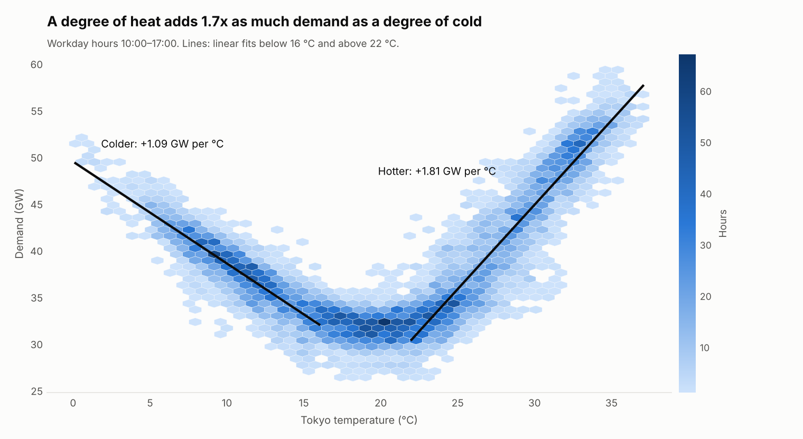
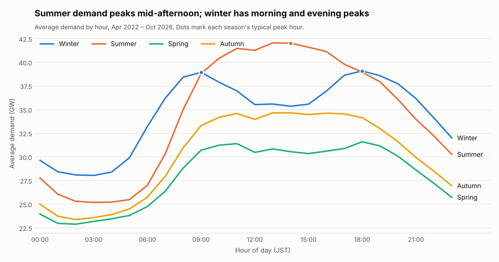
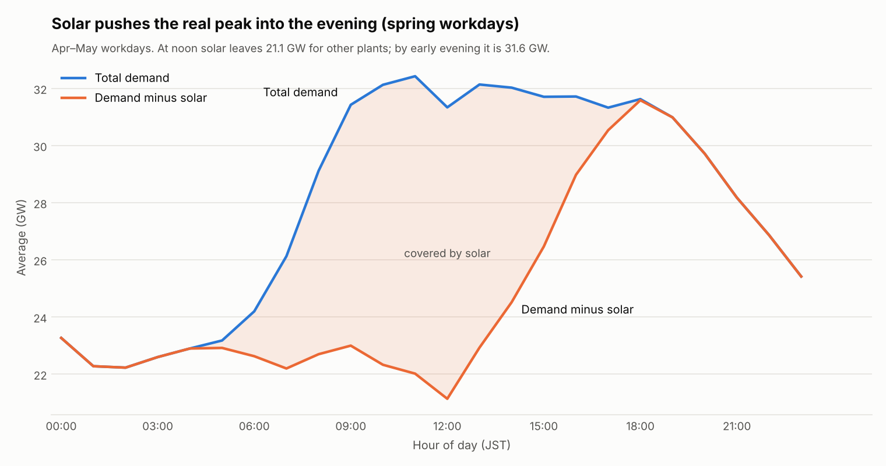
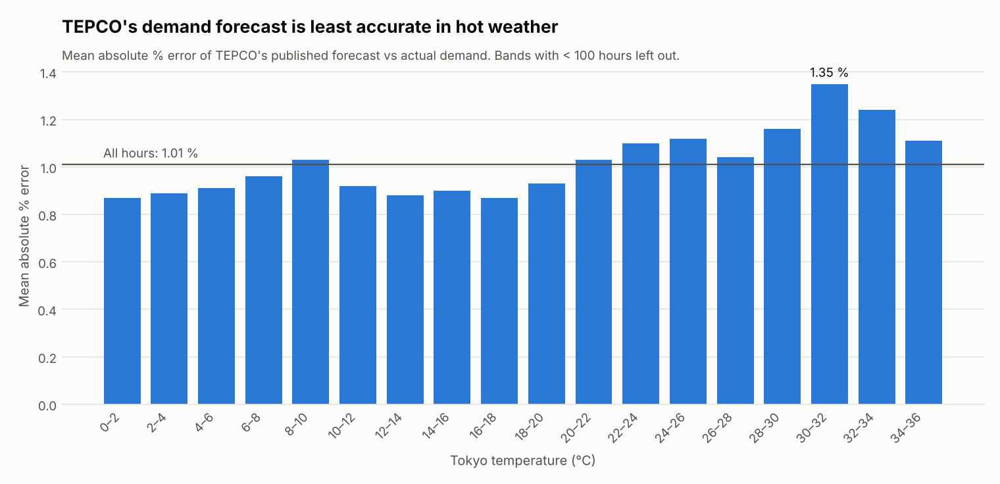

# Tokyo Electricity Demand Analysis

This project uses Python, pandas and NumPy to analyze what drives electricity demand in the Tokyo area: temperature, time of day, the calendar, or solar power.

**Data:** `tokyo_hourly_clean.csv.gz` contains 39,744 hourly records from 1 Apr 2022 to 12 Oct 2026 (JST). It was cleaned in an earlier project.
- **TEPCO Power Grid "でんき予報":** demand, TEPCO's day-ahead forecast, supply capacity, usage rate and solar output, all in GW.
- **Japan Meteorological Agency (気象庁):** hourly temperature, humidity and sunshine at the Tokyo station, plus a Kanto-wide average.

Data © TEPCO Power Grid and the Japan Meteorological Agency (processed). It was compiled through [kaseee/tokyo-grid-lab](https://github.com/kaseee/tokyo-grid-lab).

## Key findings

**1. Heat costs more than cold.** On workday daytime hours, each °C above 22 °C adds **1.81 GW** of demand (R² 0.86), and each °C below 16 °C adds **1.09 GW** (R² 0.78). A degree of heat adds about **1.7x as much demand** as a degree of cold, which is why the record peaks happen in summer.



**2. The relationship is U-shaped, so simple correlation misses it.** Demand's correlation with temperature is only **r = 0.20**. Its correlation with the **distance from about 16 °C** is **r = 0.64**. That is the temperature at which Tokyo needs neither heating nor cooling.

**3. Peak hours depend on the season and the calendar.** Summer demand peaks at **13:00–14:00**, when air conditioning is running hardest. Winter has two peaks, at **09:00 and 18:00**. Workdays run **4.1 GW above** weekends and holidays on average (up to 7.1 GW during office hours). All 5 of the lowest-demand hours in the data fall in Golden Week.



**4. Solar moves the real peak into the evening.** On spring workdays, solar cuts the demand left for other power plants from about 31 GW to **21.1 GW at noon**. That demand climbs back to **31.6 GW by 18:00**, after sunset. The highest solar hour rose **17 %**, from 15.2 GW (2022) to 17.8 GW (2026).



**5. Humidity adds load on hot days.** On afternoons at 28–34 °C, each **+10 % humidity adds about 2.2 GW** at the same temperature. This comes from a multiple regression with `np.linalg.lstsq`.

**6. Hotter summers bring higher demand and harder forecasts.** July–August hours at 35 °C or above went from **11 (2022) to 45 (2025)**, and average summer demand rose from 36.2 to 37.6 GW. TEPCO's forecast error averages **1.01 %** overall. It is lowest in mild weather (0.87 %) and highest at **30–32 °C (1.35 %)**.



## What the analysis covers

| Requirement | Where | What |
|---|---|---|
| **Basic statistics** | `basic_statistics.csv`, notebook section 1 | Mean, SD, min, max, percentiles, IQR, coefficient of variation, skew, kurtosis; a NumPy histogram of demand ranges |
| **Highest / lowest values** | `highest_lowest_values.csv`, `yearly_records.csv`, section 2 | Top and bottom 5 hours for demand and temperature; top hours for usage rate and solar; records for each year |
| **Group and compare** | `demand_by_hour_and_season.csv`, `demand_by_month.csv`, section 3 | Hour × season profiles, the peak hour in each season, workday vs weekend/holiday, by weekday, by month |
| **Trends** | `fig3_monthly_trends.png`, section 4 | Monthly averages with a 12-month rolling mean, year-by-year summer heat and demand, solar growth (trend line with `np.polyfit`) |
| **Relationships** | `correlation_matrix.csv`, `fig5_correlation_matrix.png`, section 5 | Correlation matrix, a scan for the comfort temperature, separate heating and cooling slopes, a humidity regression, solar vs sunshine, forecast accuracy |
| **Findings** | above, and notebook section 6 | 6 findings, each backed by numbers |

## Files

All files are in one folder.

| File | Contents |
|---|---|
| `tokyo_demand_analysis.ipynb` | The full analysis with outputs and charts. Start here. |
| `analysis.py` | All analysis functions. `python analysis.py` regenerates every table and chart. |
| `tokyo_hourly_clean.csv.gz` | Input data (pandas reads the `.gz` file directly) |
| `basic_statistics.csv`, `highest_lowest_values.csv`, `yearly_records.csv`, `demand_by_month.csv`, `demand_by_hour_and_season.csv`, `correlation_matrix.csv` | Output tables |
| `fig1_…png` to `fig6_…png` | Charts |
| `requirements.txt` | Python packages |

## How to run

```bash
pip install -r requirements.txt
python analysis.py                 # or open tokyo_demand_analysis.ipynb and run all cells
```

## Limitations

- The temperature effects are associations, not proven causes. Hot hours are mostly afternoons, so time of day is mixed into the temperature effect. Restricting the fits to workday hours from 10:00 to 17:00 reduces this, but doesn't remove it.
- 2022 starts in April and 2026 ends on 12 October, so the year-by-year comparisons use July–August only.
